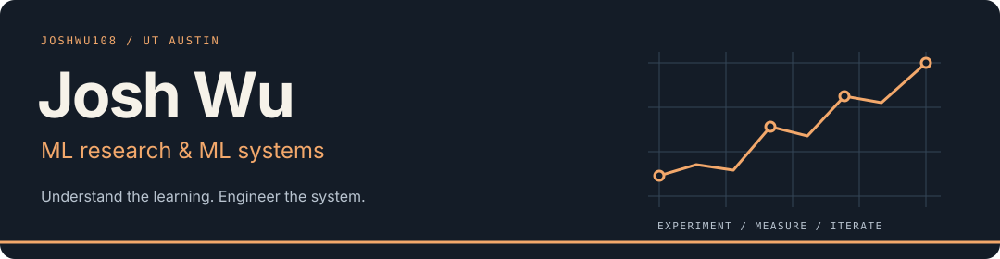

  

  <a href="https://www.linkedin.com/in/joshua-s-wu/">LinkedIn</a> &nbsp; / &nbsp;
  <a href="mailto:jsw3839@my.utexas.edu">Email</a> &nbsp; / &nbsp;
  <a href="https://github.com/joshwu108?tab=repositories">All projects</a>

## Research questions, working systems.

I'm **Josh**, a Computer Science & Math student at **UT Austin** and an **ML Systems Researcher with LDOS**. I'm interested in how learning algorithms behave in practice, and in building the infrastructure to make them faster, reproducible, and easier to understand.

My current focus is **LLM reinforcement learning, reliable training systems, and efficient generative model inference**. I like work that connects a research question to an implementation, a profiler trace, and an experiment someone else can reproduce.

### What I'm exploring

- **Learning dynamics:** off-policy drift, rollout reuse, and the gap between inference engines and trainers.
- **Trustworthy ML infrastructure:** exact sampling, verifiable experiment records, and recovery after failures.
- **Efficient inference:** GPU profiling, diffusion pipelines, and the systems bottlenecks around the model.

## Selected projects

<!-- These are the README's curated project highlights; GitHub profile pins are managed separately. -->
<table>
  <tr>
    <td width="50%" valign="top">
      01 / RL TRAINING DIAGNOSTICS
      <h3><a href="https://github.com/joshwu108/Martingale">Martingale ↗</a></h3>
      
A flight recorder and doctor for LLM RL. Tracks per-token policy revisions and log probabilities to separate rollout staleness from engine–trainer mismatch.

      
<strong>Finding:</strong> traced a silent GRPO mismatch to float32 updates below bfloat16 precision.

      
<code>Python</code> <code>PyTorch</code> <code>TRL / verl</code> <code>vLLM</code>

    </td>
    <td width="50%" valign="top">
      02 / REPRODUCIBLE REPLAY
      <h3><a href="https://github.com/joshwu108/Reservoir">Reservoir ↗</a></h3>
      
Exact, auditable replay for LLM RL. Reuses rollouts through prioritized sampling, with deterministic draws, durable storage, and an independent verifier.

      
<strong>Design:</strong> make every sampled batch reproducible and every replay decision inspectable.

      
<code>Python / C</code> <code>PyTorch</code> <code>TRL / verl</code> <code>TLA+</code>

    </td>
  </tr>
  <tr>
    <td width="50%" valign="top">
      03 / DIFFUSION SERVING
      <h3><a href="https://github.com/joshwu108/StreamDiffusionUDP">StreamDiffusionUDP ↗</a></h3>
      
My work extending StreamDiffusion with a binary UDP transport for real-time diffusion serving, including fragmentation and reassembly.

      
<strong>Result:</strong> 12% lower median serving latency than HTTP/JSON/base64 in my benchmark.

      
<code>Python</code> <code>Diffusion</code> <code>UDP</code> <code>Profiling</code>

    </td>
    <td width="50%" valign="top">
      04 / SYSTEMS FOUNDATIONS
      <h3><a href="https://github.com/joshwu108/Meridian">Meridian ↗</a></h3>
      
An eBPF-native service mesh project in Go and C. Explores kernel-level network policy, identity, telemetry, and an xDS-compatible control plane.

      
<strong>Approach:</strong> fail-closed behavior, fault injection, and benchmarks that guide what to keep.

      
<code>Go</code> <code>C / eBPF</code> <code>Linux</code> <code>gRPC</code>

    </td>
  </tr>
</table>

**Also built:** [VeneerLounge](https://github.com/joshwu108/VeneerLounge), an applied generative AI project for dental veneer previews, built through Nova Consulting.

## From research to implementation

At **UT Austin LDOS**, I've worked on GPU profiling and real-time diffusion pipelines, including improving a two-GPU video diffusion pipeline from **17.4 to 41.4 FPS** by identifying and replacing a VAE bottleneck. Previously, I worked on transaction search infrastructure at **Visa** and retrieval and research tools at **MIT CSAIL & Harvard**.

| Area | Tools I work with |
| :--- | :--- |
| ML & experiments | Python, PyTorch, JAX, NumPy, CUDA, OpenCV |
| Systems & performance | C++, C, Go, Linux, eBPF, profiling |
| Infrastructure & data | Docker, Kubernetes, AWS, PostgreSQL, Kafka, OpenSearch |

---

Interested in **ML research, training infrastructure, or inference systems**? [Let's connect.](https://www.linkedin.com/in/joshua-s-wu/)
